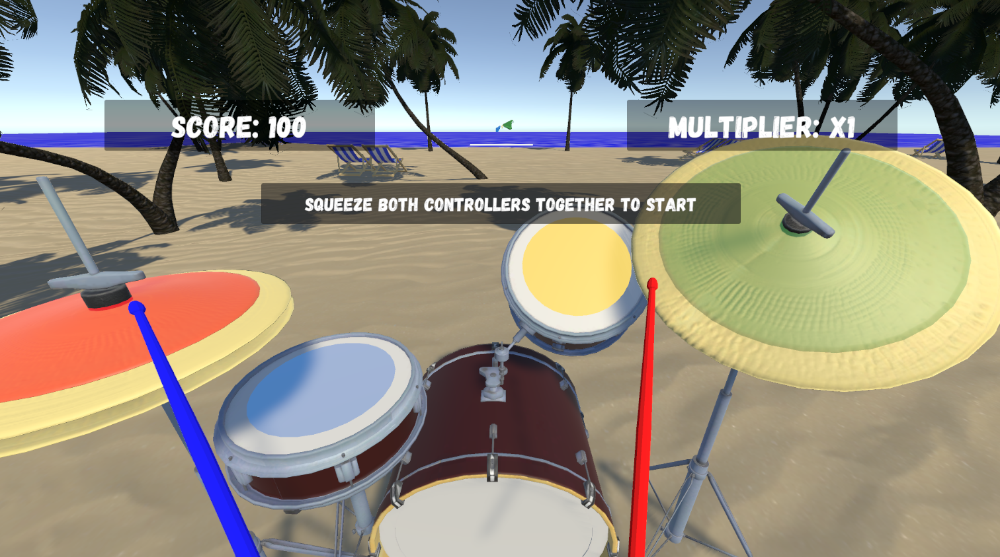

# DrumFlow
Created by Jacob Beason Entwistle during the TG0 mini-placement. (Aug-Sept 2025)

## Overview
**DrumFlow** is a fun rhythm game where the player takes on the role of a drummer.
This game's main purpose is to aid with rehabilitation by making it more interactive and engaging.

## Unity Project Details
- **Unity Version:** 2022.3.40f1
- **Start Scene:** `Assets/Scenes/Initialisation.unity`

***IMPORTANT:*** Always start the game from `Assets/Scenes/Initialisation.unity`. Other scenes may produce errors because required systems are initialised through this scene.

## Dependencies
- **etee Controllers:** Used for controller input and gameplay interaction.
- **eteeAPI:** Required to communicate with the etee controllers.
- **FMOD Studio:** Used for audio integration and playback. The FMOD Unity integration and generated audio banks must be included in the project for audio to work correctly. FMOD Studio is required if you want to modify the audio project or regenerate the banks.

## Audio

All in-game sound effects and drum sounds are included via FMOD banks, which are included in the project. The following audio assets are used in the game:

- **Original Soundtrack:** composed by Jacob Beason Entwistle
    - `Good Vibes - DrumFlow.mp3`
    - `The Basics - DrumFlow.mp3`
    - `Rockin' On - DrumFlow.mp3`

All music files are included in the repo under:
`Assets/LevelMusic/`

**Drum Sounds:** Sourced from the Freesound pack "Ian&#x27;s Drum Set" (Attribution 3.0)
- Author: [ianhall](https://freesound.org/people/ianhall/)
- Pack: [https://freesound.org/people/ianhall/packs/691/](https://freesound.org/people/ianhall/packs/691/)
- License: [Attribution 3.0](http://creativecommons.org/licenses/by/3.0/)

**Additional Sound Effects:** Ocean Ambience
- Author: [xserra](https://freesound.org/s/161701/)
- Source: [Freesound](https://freesound.org/s/161701/)
- License: [Attribution 4.0](https://creativecommons.org/licenses/by/4.0/)

> All drum sounds and the ocean ambience are integrated into FMOD banks and do not need to be added separately to the repo.

## How to Run
1. Clone/download the repo.
2. Open the project in Unity **2022.3.40f1**.
3. Open `Assets/Scenes/Initialisation.unity` and press **Play**.

## Credits
- Game Design & Programming: Jacob Beason Entwistle
- Original Soundtrack: Jacob Beason Entwistle
- Drum Sound Effects: Free-to-use sound pack (credited above)
- Additional Sound Effects: Ocean ambience (credited above)
